# YouTube Replication Project Generator & Sequential Queue (`youtube-replication-generator`)

A universal, cross-LLM project generator and sequential queue manager that takes any **YouTube video link**, reverse-engineers what was done, conducts **deep gap-closing research** on any under-specified details, generates a reviewable plan, waits for your **"OK"**, and then executes your approved projects **strictly one at a time**—ending each replication with a verified, repeatable **Step-by-Step Tutorial**.

Compatible out-of-the-box with **Antigravity**, **Claude Code** (`CLAUDE.md`), **OpenAI Codex / ChatGPT / Cline / Aider** (`AGENTS.md`), **Cursor** (`.cursorrules`), and **GitHub Copilot** (`.github/copilot-instructions.md`).

---

## How It Works (Two-Stage Workflow + Single-Active-Project Queue)

```mermaid
flowchart LR
    subgraph Stage1["STAGE 1: Load Video, Research Gaps & Plan (Stops for Your OK)"]
        A["1. Load YouTube Link (`yt_queue.py add`)"] --> B["1.1 DECONSTRUCTION.md (Filter Noise, Flag [UNSPECIFIED] Gaps)"]
        B --> C["1.2 RESEARCH_SYNTHESIS.md (External Research, Options & Informed Opinions)"]
        C --> D["1.3 REPLICATION_BLUEPRINT.md + 1.4 AGENT_INSTRUCTIONS.md"]
        D --> E["Status: STAGE_1_AWAITING_OK (HARD STOP)"]
    end
    E ==>|"You Review & Say 'OK' (`yt_queue.py approve`)"| F["Status: APPROVED_QUEUED"]
    subgraph Stage2["STAGE 2: Work on Approved Projects ONE AT A TIME (`max_concurrent_active = 1`)"]
        F --> G["Claim Next Approved Project (`yt_queue.py start-next`)"]
        G --> H["Build & Test in `replications/<NNN>-<slug>/`"]
        H --> I["Satisfaction Gate (`VERIFICATION_REPORT.md` + `mark-verified`)"]
        I -->|"Confirmed Satisfactory"| J["Final Step: `STEP_BY_STEP_TUTORIAL.md` (`yt_queue.py complete`)"]
    end
```



---

## Quick-Start for Any LLM Service

### 1. Load a New YouTube Link (Stage 1 — Stops for Your Review)
Give any LLM connected to this repository a YouTube URL:
> *"Load this YouTube link into the generator and prepare Stage 1 for my review: `https://www.youtube.com/watch?v=...`"*

The LLM will automatically:
1. Run `python3 scripts/yt_queue.py add "<youtube_url>" --slug "<slug>" --title "<title>"` to scaffold `replications/<NNN>-<slug>/`.
2. Write **`DECONSTRUCTION.md`** (filtering noise, extracting `[Timestamp]` steps, flagging `[UNSPECIFIED - Verify before starting]` gaps, and identifying 2–3 "Off-Camera" traps).
3. Write **`RESEARCH_SYNTHESIS.md`** (researching external documentation, repos, and benchmarks for every under-specified part of the video, comparing 2–3 options, and giving well-rounded opinions/recommendations).
4. Write **`REPLICATION_BLUEPRINT.md`** (the 4-part Creative Project Reverse-Engineer plan) and **`AGENT_INSTRUCTIONS.md`** (standalone builder instructions).
5. Run `python3 scripts/yt_queue.py mark-planned <id>` and **stop for your review**.

### 2. "OK" the Projects You Want Built
Review `RESEARCH_SYNTHESIS.md` and `REPLICATION_BLUEPRINT.md`. When you're happy with one or more plans, tell the LLM:
> *"OK project `002` (and `003`). Work on the approved queue one at a time."*

Or run from the terminal:
```bash
python3 scripts/yt_queue.py approve 002
```

### 3. Build Approved Projects Strictly One at a Time (Stage 2)
When instructed to build, the LLM runs:
```bash
python3 scripts/yt_queue.py start-next
```
- **Single-Active-Project Lock (`max_concurrent_active = 1`)**: Even if you have OK'd 5 projects, `yt_queue.py start-next` locks the queue to **1 active project at a time**.
- The agent builds and tests the active project inside `replications/<NNN>-<slug>/`, writes `VERIFICATION_REPORT.md` (`python3 scripts/yt_queue.py mark-verified <id>`), confirms satisfaction at the **Satisfaction Gate**, writes `STEP_BY_STEP_TUTORIAL.md` as the final step, and runs `python3 scripts/yt_queue.py complete <id>` to unlock the next OK'd project in line.

---

## Repository Contents

- [`replications/INDEX.md`](replications/INDEX.md) — Auto-synced dashboard of all queued, in-progress, and completed video sub-projects.
- [`QUEUE.json`](QUEUE.json) — Machine-readable queue state and single-active-project lock.
- [`scripts/yt_queue.py`](scripts/yt_queue.py) — Zero-dependency Python 3 CLI generator and state machine.
- [`replications/001-ai-niche-directory-side-hustle/`](replications/001-ai-niche-directory-side-hustle) — Complete working reference replication of `https://www.youtube.com/watch?v=NhqSuQPPvbg` (*"The EASIEST AI Side Hustle To Start Today (Copy This)"*), including all 6 stage documents, Python modules, unit tests, and compiled HTML5 directory web apps.
- [`docs/`](docs) — Full framework specifications ([`META_INSTRUCTIONS.md`](docs/META_INSTRUCTIONS.md), [`REPLICATION_INSTRUCTIONS.md`](docs/REPLICATION_INSTRUCTIONS.md), [`GOAL_PROMPT.md`](docs/GOAL_PROMPT.md), [`archetype-playbooks.md`](docs/archetype-playbooks.md)).
- [`templates/`](templates) — Markdown templates used by `scripts/yt_queue.py` when scaffolding new sub-projects.

---

## CLI Reference (`scripts/yt_queue.py`)

```bash
# View queue status and active lock
python3 scripts/yt_queue.py status

# 1. Add a new YouTube video link (creates replications/<NNN>-<slug>/)
python3 scripts/yt_queue.py add "https://www.youtube.com/watch?v=..." --slug "my-video-project" --title "My Video Title"

# 2. Mark Stage 1 complete (verifies DECONSTRUCTION.md, RESEARCH_SYNTHESIS.md, REPLICATION_BLUEPRINT.md, AGENT_INSTRUCTIONS.md)
python3 scripts/yt_queue.py mark-planned 002

# 3. Approve ("OK") a planned project for execution
python3 scripts/yt_queue.py approve 002

# 4. Claim the next approved project for Stage 2 execution (enforces max 1 active project!)
python3 scripts/yt_queue.py start-next

# 5. Enter the Satisfaction Gate (verifies VERIFICATION_REPORT.md exists)
python3 scripts/yt_queue.py mark-verified 002

# 6. Complete the project (verifies STEP_BY_STEP_TUTORIAL.md exists & releases the single-project lock)
python3 scripts/yt_queue.py complete 002
```

---

## Generator Evolution & Immutable Plan Versioning (`scripts/yt_evolve.py`)

The generator learns from every completed sub-project **without breaking any project currently in progress**:

1. **Self-Evolving Knowledge Base ([`evolution/`](evolution))**:
   - [`evolution/LESSONS_LEARNED.json`](evolution/LESSONS_LEARNED.json) and [`evolution/EVOLUTION_LOG.md`](evolution/EVOLUTION_LOG.md) store verified off-camera traps, parameter formulas, and BOM substitutions from completed projects.
   - `yt_queue.py add` automatically injects relevant past lessons into every new sub-project's `RESEARCH_SYNTHESIS.md`.
   - Record new lessons after completing a project:
     ```bash
     python3 scripts/yt_evolve.py record-lesson --project "002-my-project" --archetype "Archetype B/C" --category "off-camera-trap" --title "..." --problem "..." --solution "..."
     ```
2. **Immutable Plan & Generator Versioning ([`versions/`](versions) + `plans/vN/`)**:
   - Every sub-project pins its `generator_version` (from [`VERSION`](VERSION)) and `plan_version` (`1`, `2`, ...) in [`QUEUE.json`](QUEUE.json) and `PLAN_MANIFEST.json`.
   - `mark-planned` freezes an immutable copy of Stage 1 into `replications/<NNN>-<slug>/plans/v1/`. Use `python3 scripts/yt_queue.py revise-plan <id> --reason "..."` to create `plans/v2/` without overwriting `v1/`.
   - When you improve templates or playbooks, archive a new immutable generator release (`versions/v1.2.0/`) without affecting any in-progress project:
     ```bash
     python3 scripts/yt_evolve.py bump-version 1.2.0 --summary "Improved Stage 1 research template"
     ```
