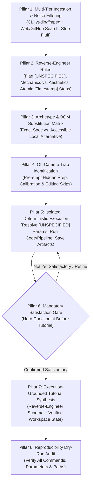

# Meta-Instructions: Designing Optimal Instructions for YouTube Video Replication & Tutorial Synthesis

## 1. Purpose & Meta-Problem Statement

We want to design the best possible instruction set (system prompt, agent workflow, skill, or `/goal` specification) for the following downstream task:

> *"Take the provided YouTube video link `[YouTube Link]` and replicate what was done. Make sure to create a step-by-step tutorial as the last step, after the replication has been confirmed as satisfactory."*

### Why Naive Prompts Fail—And Why We Combine Two Paradigms

When designing instructions for this task, there are two complementary paradigms that must be fused together:

1. **Paradigm 1: The Creative/Technical Project Reverse-Engineer (Deconstruction & Blueprinting)**
   - YouTube videos are filled with narrative fluff, sponsor segments, jump-cut montages, unstated parameters, and "off-camera" preparation.
   - A Reverse-Engineer mindset applies four strict rules to extract a clean blueprint from messy video media:
     1. **Filter Noise**: Strip out intros, sponsors, channel plugs, and storytelling filler; retain only technical and creative execution details.
     2. **Flag Missing Data (`[UNSPECIFIED - Verify before starting]`)**: Never silently guess hidden measurements, settings, versions, or parameters skipped by the creator. Explicitly tag them so they can be verified or empirically resolved during replication.
     3. **Separate Mechanics from Aesthetics**: Distinguish between **structural mechanics** (required for the project/pipeline to function) and **stylistic/aesthetic choices** (niche, persona, color palette, sample data) that can be customized.
     4. **Chronological & Atomic Decomposition**: Break fast editing montages into sequential, single-action steps anchored to `[Timestamp]`, each with its *Critical Parameter* and *Verification* check, backed by a **Bill of Materials (BOM) & Tool Substitutions** table and an **"Off-Camera" Traps** analysis.

2. **Paradigm 2: The Autonomous Execution & Gated Verification Agent (Replication -> Confirmation -> Tutorial)**
   - A blueprint alone only *describes* what the video did; it does not *replicate* it or prove that the blueprint actually works.
   - An Agentic Execution workflow takes the Reverse-Engineered Blueprint, executes it in an isolated workspace (using the *Accessible Alternatives* from the BOM table whenever proprietary/hardware walls arise), empirically resolves `[UNSPECIFIED]` parameters, verifies every step, **stops at a mandatory Satisfaction Gate** for user confirmation, and finally synthesizes the **Step-by-Step Tutorial** as the last step—grounded in both the Reverse-Engineer structure and the verified execution artifacts.

---

## 2. The 8 Design Pillars for Video-Replication Instructions

Any high-performing instruction set for this task must be architected around eight core pillars:



### Pillar 1: Multi-Tier Video Ingestion & Noise Filtering
Never write instructions that assume a single tool (like `yt-dlp` or a transcript plugin) will always succeed or suffice. Instruct the agent to execute a **3-tier ingestion waterfall** while strictly filtering out intros, sponsors, channel plugs, and narrative fluff:
- **Tier 1 — Direct CLI & Visual Cue Extraction (When Network/Host Permits)**:
  - Use `yt-dlp --write-info-json --write-auto-sub --write-sub` to extract description links, chapters, timestamps, and captions.
  - Use `ffmpeg` scene-change detection (`select='gt(scene,0.3)'`) or timestamp sampling at key transitions to inspect visual cues, node graphs, code editors, diagrams, and terminal outputs.
- **Tier 2 — Web Ecosystem, Companion Repo & Summary Discovery (Always Run)**:
  - Search via `google_search` (`"<video_id>" youtube`, `"<video_title>" github`, creator name + topic) and `gh search repos` / `gh search code`.
  - Locate official or community open-source reimplementations, companion gists, technical blog writeups, or structured transcript summaries (`youtubesummary.com`, creator blogs, Substack).
- **Tier 3 — User-Assisted Fallback**:
  - If both direct download and web indexing lack critical private details, ask the user for the transcript or video file in `/home/antigravity/upload/`.

### Pillar 2: The 4 Strict Reverse-Engineering Rules
During deconstruction and blueprinting, the instructions must enforce four non-negotiable rules:
1. **Filter Noise**: Discard sponsor reads, engagement bait, and narrative filler.
2. **Flag Missing Data (`[UNSPECIFIED - Verify before starting]`)**: Whenever a creator skips a parameter (e.g., an FFT window size, a prompt template, a learning rate, or a tool setting), explicitly tag it as `[UNSPECIFIED - Verify before starting]` in the blueprint—and then document how it was empirically resolved during execution.
3. **Separate Mechanics from Aesthetics**: Tag every step or component as either **[MECHANIC]** (structural requirement for the system/project to work) or **[AESTHETIC]** (stylistic choice such as persona theme, color scheme, UI styling, or sample topic that can be freely customized).
4. **Chronological & Atomic Decomposition**: Unpack fast editing montages into sequential, single-action steps anchored to `[Timestamp]` with explicit *Critical Parameters* and *Verification* checks.

### Pillar 3: Video Archetype Taxonomy & Bill of Materials (BOM) Substitutions
Videos span radically different domains. The instructions must classify the video into an **Archetype** and construct a **Bill of Materials & Tool Substitutions Table** combined with a **Feasibility Tier**:

| Archetype | Description | Primary Replication Strategy |
| :--- | :--- | :--- |
| **A. Algorithmic / Scientific / OSINT Demo** | Explains a mathematical, physical, or computational technique and demonstrates a result (e.g., `UytYrhYLOKI`). | Formulate the pipeline stages mathematically; check for companion repos (`gh` / web); run on demo/sample data; use CPU fallbacks (`numba`) or bounded datasets when GPU/multi-GB archives are impractical. |
| **B. Multi-Tool AI / Creative / Business Workflow** | Chains multiple SaaS tools, prompts, assets, and distribution channels (e.g., `LlhTEttKcwQ`). | Build an end-to-end local automation & asset pipeline: execute research, prompt/skill engineering, scriptwriting, local media synthesis, and digital product creation locally; package external SaaS/social steps into turnkey kits. |
| **C. Software Engineering / DevOps Tutorial** | Walks through coding an app, API, model, or infrastructure setup. | Reconstruct the full repository, modernize broken/deprecated dependencies, run builds/linters/tests, and launch a live preview or CLI verification. |
| **D. Creative / GUI / Physical-Digital Walkthrough** | Demonstrates node graphs, design tools, 3D/video editing, or craft/fabrication workflows. | Extract the underlying declarative parameters, node settings, scripts, or templates; build automated/programmatic equivalents alongside the atomic manual steps. |

Every item in the **Bill of Materials & Tool Substitutions** table must map:
`| Item / Software | Exact Spec / Setting Used | Purpose in Project | Accessible Alternative | Execution Mode ([LOCAL-FULL] / [LOCAL-ADAPTED] / [HITL-PACKAGED]) |`

### Pillar 4: Pre-Empting "Off-Camera" Traps
Creators routinely gloss over tedious prep work in editing—such as audio format resampling, environment calibration, dependency version conflicts, rate limits, or prompt iteration failures. Instructions must require the agent to explicitly identify **2–4 "Off-Camera" Traps** *before* execution so the agent's replication scripts handle them automatically and the final tutorial warns the reader.

### Pillar 5: Isolated Deterministic Execution & Resolution of `[UNSPECIFIED]` Data
Instructions must forbid "theater" (writing placeholder stubs or claiming something works without running it):
- Work inside a dedicated directory (`/home/antigravity/replications/<video-slug>/`).
- Pin environments reproducibly (`uv venv`, `pyproject.toml`, `package.json`, or `Makefile`).
- Empirically test and resolve every parameter initially tagged as `[UNSPECIFIED - Verify before starting]`, recording the exact working value discovered.
- Save verbatim command outputs, generated artifacts, metrics, and plots to `/home/antigravity/replications/<video-slug>/artifacts/`.

### Pillar 6: The Mandatory Satisfaction Gate (Hard State Boundary)
The user's prompt specifies:
> *"Make sure to create a step-by-step tutorial as the last step, **after the replication has been confirmed as satisfactory**."*

To enforce this reliably:
- **State Machine Rule**: Phase 4 (Verification & Confirmation) is a **hard blocking gate**.
- **Evidence Presentation**: Present a structured **Replication Verification Report** summarizing:
  1. Project Overview, Skill Bottleneck, and Active vs. Passive Execution Time.
  2. Bill of Materials & Tool Substitutions used during replication.
  3. Stage-by-Stage Verification Table (including how `[UNSPECIFIED]` parameters and "Off-Camera" traps were resolved).
  4. Quantitative/qualitative comparison between the video's claims and actual outputs.
- **Explicit Confirmation Mechanism**:
  - In **Interactive Mode** (including interactive `/goal` runs): Call `ask_question` asking whether the replication is satisfactory or needs specific refinements. If refinements are requested, loop back to Phase 3.
  - In **Unattended / Overnight Mode**: Require passing a strict 5-point programmatic self-audit in `VERIFICATION_REPORT.md` before unlocking Phase 5.

### Pillar 7: Execution-Grounded Tutorial Synthesis (Merging Reverse-Engineer Structure with Verified Execution)
Once (and only once) the replication is confirmed as satisfactory:
- **Golden Rule**: Synthesize the final `STEP_BY_STEP_TUTORIAL.md` by combining the **Creative Project Reverse-Engineer output structure** with the **verified commands, resolved parameters, actual files, and real outputs** from Phase 3.
- Specifically, the final tutorial must include:
  1. **Project Overview & Prerequisites** (Core Concept, Skill Level & Single Hardest Bottleneck, Estimated Active vs. Passive Time, Architecture Diagram).
  2. **Bill of Materials & Tool Substitutions Table** (`Item / Software`, `Exact Spec / Setting Used`, `Purpose in Project`, `Accessible Alternative`).
  3. **Chronological & Atomic Step-by-Step Replication Guide** grouped into logical phases, where each step has:
     - `[Timestamp] Action Title` + `[MECHANIC]` vs. `[AESTHETIC]` tag
     - Clear imperative instruction + exact tested code/commands/prompts
     - *Critical Parameter* (noting both the video's spec and any `[UNSPECIFIED]` parameter resolved during our replication)
     - *Verification* (exact expected output from our Phase 3 run)
  4. **"Off-Camera" Traps & Troubleshooting** (both inferred editing skips and real bugs/traps encountered and solved during Phase 3).

### Pillar 8: Reproducibility Dry-Run Audit
Cross-check every file path, command flag, parameter value, and expected output snippet inside `STEP_BY_STEP_TUTORIAL.md` against the actual workspace state before completion.

---

## 3. Meta-Prompt Template (For Generating Custom Replication Instructions)

Use the following **Meta-Prompt** whenever you want an LLM or agent to design a tailored set of replication instructions for a specific class of YouTube videos or a specialized execution environment:

```markdown
# META-PROMPT: Instruction Architect for YouTube Video Replication & Blueprinting

You are a Principal Agentic Workflow Architect and Creative Project Reverse-Engineer. Your objective is to write a complete, deterministic instruction specification (System Prompt / Skill / `/goal` Prompt) that directs an AI agent to:
1. Ingest and reverse-engineer a target YouTube video (`[YouTube Link]`).
2. Replicate what was demonstrated in the video with high technical and creative fidelity.
3. Confirm with the user (or against strict acceptance criteria) that the replication is satisfactory.
4. Generate a comprehensive, repeatable step-by-step tutorial ONLY as the final step after satisfaction is confirmed.

## Step 1: Analyze the Target Context
- **Target Video URL / Domain**: [Insert YouTube Link or Video Category]
- **Agent Capabilities & Constraints**: [e.g., Linux shell, Python/uv, Node.js, ffmpeg, web search/browse, GitHub CLI, image generation, interactive ask_question tool]
- **Confirmation Mode**: [Interactive User Sign-Off vs. Unattended Objective Gate]

## Step 2: Enforce the 4 Strict Reverse-Engineering Rules Across All Phases
1. **Filter Noise**: Ignore intros, sponsors, channel plugs, and narrative fluff.
2. **Flag Missing Data**: Never silently guess hidden measurements, settings, or materials. Label omitted parameters as `[UNSPECIFIED - Verify before starting]`, then empirically test and resolve them during replication.
3. **Separate Mechanics from Aesthetics**: Tag structural steps required for function as `[MECHANIC]` and customizable stylistic choices as `[AESTHETIC]`.
4. **Chronological & Atomic**: Break complex montages into individual, sequential `[Timestamp]` actions—one action per step—with explicit *Critical Parameters* and *Verification* checks.

## Step 3: Structure the Instructions as a 5-Phase Gated State Machine
1. **PHASE 1 — Multi-Tier Ingestion & Noise-Filtered Extraction (`DECONSTRUCTION.md`)**:
   - Direct extraction (`yt-dlp`, `ffmpeg` visual keyframes) + Web/GitHub ecosystem discovery (`google_search`, `google:browse`, `gh`).
2. **PHASE 2 — Reverse-Engineered Blueprint & BOM (`REPLICATION_BLUEPRINT.md`)**:
   - Include: (1) Project Overview, Skill Level & Hardest Bottleneck, Active vs. Passive Time; (2) Bill of Materials & Tool Substitutions Table (`Item / Software | Exact Spec / Setting Used | Purpose in Project | Accessible Alternative | Execution Mode`); (3) Atomic `[Timestamp]` Steps with `[MECHANIC]`/`[AESTHETIC]` tags, *Critical Parameters* (flagging `[UNSPECIFIED]`), and *Verification*; (4) "Off-Camera" Traps.
3. **PHASE 3 — Iterative Implementation & Evidence Capture (`workspace/` + `artifacts/`)**:
   - Execute the blueprint in an isolated directory, using *Accessible Alternatives* where needed and resolving all `[UNSPECIFIED]` parameters through real execution.
4. **PHASE 4 — The Satisfaction Gate (`VERIFICATION_REPORT.md` + User Checkpoint)**:
   - Present proof of execution, resolved parameters, comparison against video claims, and links to all outputs.
   - HARD STOP: Request user confirmation that the replication is satisfactory. Loop back to Phase 3 if adjustments are requested. Do NOT write the tutorial yet.
5. **PHASE 5 — Execution-Grounded Tutorial Synthesis (`STEP_BY_STEP_TUTORIAL.md`)**:
   - After confirmation, synthesize the final tutorial combining the Reverse-Engineer structure (Overview/Bottlenecks/Time, BOM & Substitutions, Atomic `[Timestamp]` Steps with *Critical Parameters* & *Verification*, and "Off-Camera" Traps & Troubleshooting) with the verified code, commands, and outputs from Phase 3.
```

---

## 4. Worked Case Studies: Applying the Unified Framework to Your Reference Videos

### Case Study 1: `https://www.youtube.com/watch?v=UytYrhYLOKI&t=2s`
- **Title**: *"I discovered a sound that leaks your exact location (and it's everywhere)"* (Colsto)
- **1. Project Overview & Prerequisites**:
  - **Core Concept**: An OSINT audio-forensics pipeline that extracts the Doppler frequency-shift curve of overhead propeller aircraft from ambient video audio and cross-references it against public ADS-B flight tracks to pinpoint the recording location within ~100 meters.
  - **Skill Level & Bottleneck**: Advanced (Signal Processing & Spatiotemporal Optimization). **Single Hardest Bottleneck**: Tracing clean propeller blade-passing frequency ridges in heavily compressed YouTube audio while filtering out close-range road vehicles (<150 m or <30 m/s) and matching against multi-gigabyte daily ADS-B archives.
  - **Estimated Time**: Active setup/coding time: ~20 minutes; Passive compute/download time: ~36 seconds for CPU spectrogram `detect` stage, plus 10–30 minutes passive download/ingest for a ~3.5 GB daily ADS-B archive.
- **2. Bill of Materials & Tool Substitutions**:

| Item / Software | Exact Spec / Setting Used | Purpose in Project | Accessible Alternative |
| :--- | :--- | :--- | :--- |
| Audio Extractor | `yt-dlp` (WebM/Opus audio stream) | Extract raw audio track from target video (`0:00–29:12`) | Local `.wav`/`.webm` sample or `ffmpeg -i` extraction |
| Spectrogram & Matched Filter Engine | Custom CUDA / Python DSP (`108` aircraft Doppler templates; straight-line flyby fit) | Detect aircraft CPA time, base frequency $f_0$, speed, and slant range | `digitalis-p/doppler-locate` (`dopploc detect`) with `numba` CPU fallback (no GPU required) |
| Flight Track Archive | `adsb.lol` daily history archive (`~3.5 GB/day`, ODbL) + ICAO type table | Ground-truth aircraft positions, speeds, and altitudes | Bounded regional/time parquet subset or `cases/` demo dataset for fast local verification |
| Environmental Corrections | Copernicus GLO-90 DEM + NOAA GFS 0.25° wind/temp `[UNSPECIFIED in video narration - resolved via companion repo]` | Correct sound propagation speed and terrain masking | Standard atmosphere fallback ($c \approx 343\text{ m/s}$) for initial local fit |

- **3. Mechanics vs. Aesthetics & Atomic `[Timestamp]` Breakdown (Sample)**:
  - **[00:00–26:40] Narrative & Physics Explanation**: Filtered as conceptual background; extracts the core mathematical mechanics ($f(t)$ Doppler hyperbolic sweep) while flagging exact STFT window parameters as `[UNSPECIFIED in video - resolved via doppler-locate defaults]`.
  - **[26:51–29:07] `[MECHANIC]` Field Recording Doppler Detection**: Run matched filter across the field recording segment to isolate high-confidence aircraft passes (`CPA 26:51, f0=73.6 Hz, RMS=0.31 Hz` and `CPA 27:49, f0=177.1 Hz, RMS=0.20 Hz`) and reject road vehicles.
- **4. "Off-Camera" Traps Identified**:
  1. **Road Vehicle False Positives**: Cars and motorcycles also create Doppler sweeps; without the `< 150 m` CPA distance or `< 30 m/s` speed rejection filter, road traffic scrambles the aircraft table.
  2. **YouTube Audio Compression**: Opus/AAC compression degrades high-frequency harmonics and introduces spectral artifacts.
  3. **CUDA Build Failure on CPU Machines**: The native C/CUDA kernel fails on non-NVIDIA machines unless the `numba` CPU fallback environment is configured.

---

### Case Study 2: `https://www.youtube.com/watch?v=LlhTEttKcwQ`
- **Title**: *"I Tried The LAZIEST Way to Make Money With AI"*
- **1. Project Overview & Prerequisites**:
  - **Core Concept**: An 8-stage "AI Influencer" content and digital-product monetization pipeline that tests three AI avatar personas across Health, Wealth, and Relationships, then monetizes the winning persona (*Amos*, 101-year-old remedies) with an interactive **30-Day Habit Workbook** ("30-Day Energy Reset / Start the Old Ways Challenge").
  - **Skill Level & Bottleneck**: Beginner–Intermediate (Prompt Engineering, Multi-Tool Asset Assembly, Offer Design). **Single Hardest Bottleneck**: Maintaining visual/character consistency across angles and scenes while designing a digital product (interactive habit tracker workbook) that converts viewers rather than a generic ebook.
  - **Estimated Time**: Active creation time: ~3–4 hours (building personas, reusable script skills, 30 scripts, and the 30-day workbook); Passive time: ~30–60 minutes rendering images/voice/9:16 videos + 2–7 days passive social distribution window.
- **2. Bill of Materials & Tool Substitutions**:

| Item / Software | Exact Spec / Setting Used | Purpose in Project | Accessible Alternative |
| :--- | :--- | :--- | :--- |
| LLM Persona & Script Engine | Claude (Free/Pro) + Custom "Skills" (`[UNSPECIFIED exact skill prompt text - reverse-engineered]`) | Generate 3 character backstories, voice prompts, and viral short-form scripts | Antigravity direct synthesis + local reusable Markdown prompt skill templates |
| Visual & Voice Generator | Higgsfield + Claude Connector (Assumed \$99 plan in video) | Multi-angle realistic aged character photos + voice audio | Antigravity `generate_image` tool + OpenAI/Edge-TTS/local TTS script + ready-to-paste Higgsfield prompt pack |
| Video Assembler | Cinema Studio / Instagram Edits (`9:16` aspect ratio, `1080p`) | Combine character visuals, voice audio, and captions into Reels | Automated `ffmpeg` `9:16` `1080x1920` vertical video builder script with burned-in subtitles |
| Digital Product & Storefront | Interactive 30-Day Habit Workbook on Stan Store (\$15.99 discounted to \$12.00) + PayPal | Monetize audience via bio link checkout | Self-contained interactive HTML/print-ready PDF **30-Day Old Ways Energy Reset Workbook** + Stan Store copy kit |

- **3. Mechanics vs. Aesthetics Distinction**:
  - **`[MECHANIC]`**: Multi-niche A/B/C testing structure, hook-first short-form script architecture, 9:16 1080p vertical framing, and an action-oriented daily habit checklist workbook instead of a passive ebook.
  - **`[AESTHETIC]`**: The specific character personas (*Amos* the 101-year-old health elder, *Grandma Vivienna* the bougie wealth grandma, *Sienna* the dating persona) and visual styling.
- **4. "Off-Camera" Traps Identified**:
  1. **Uncanny / Too-Young AI Age Rendering**: Default diffusion models render "elderly" prompts as 55-year-old models with gray hair; requires explicit skin-texture, lighting, and imperfection parameters (as happened with *Amos* initially looking too young).
  2. **The "Generic Ebook" Conversion Trap**: Viewers rarely buy generic AI-written ebooks they can Google for free; the offer must be structured as a daily interactive mechanism (tick-boxes, fridge tracker, daily named rules).
  3. **Transcript Math Hallucination**: The video's auto-transcript garbles the final cost/profit readout ("\$11,852 cost / \$15,748 profit" vs. 23 sales × \$12 = \$276 revenue on a \$99 budget)—a classic example of why agents must audit numbers rather than blindly repeating transcript text.
