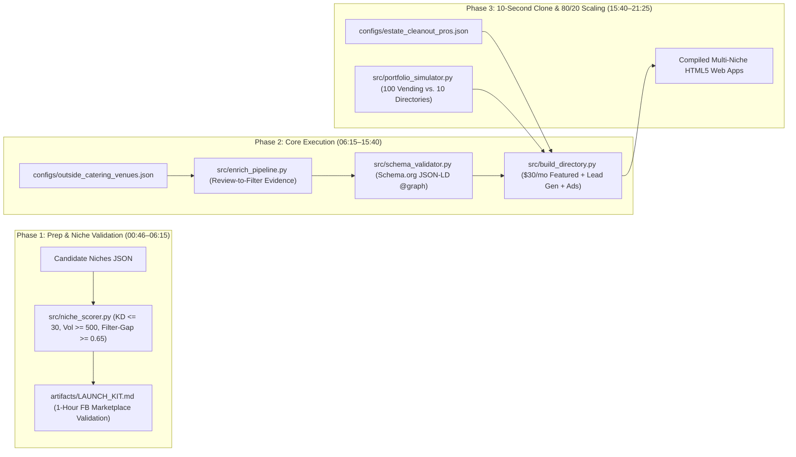

# Step-by-Step Tutorial: Replicating Chris Koerner's AI Niche Directory Side Hustle & 80/20 Portfolio Engine

- **Source Video**: [The EASIEST AI Side Hustle To Start Today (Copy This)](https://www.youtube.com/watch?v=NhqSuQPPvbg) (`21:25`, *The Diary Of A CEO Clips* — Steven Bartlett & Chris Koerner)
- **Verified Workspace**: [`/home/antigravity/replications/ai-niche-directory-side-hustle/`](file:///home/antigravity/replications/ai-niche-directory-side-hustle)
- **Verification Report**: [`VERIFICATION_REPORT.md`](file:///home/antigravity/replications/ai-niche-directory-side-hustle/VERIFICATION_REPORT.md)
- **Interactive Web App Artifact**: [`caterfree_ai_directory_app.html`](file:///home/antigravity/.gemini/jetski/brain/v1/default/jetski_remote_agents_3p/c1ed4337-9644-4002-bb7c-72ddef267b48/caterfree_ai_directory_app.html)

---

## 1. Project Overview & Prerequisites

- **Core Concept:** Build, validate, monetize, and clone hyper-specific **AI Niche Directory Web Applications** that solve a "Filter-Gap" problem ignored by Yelp and Google Maps (such as *CaterFree Venues: Event Venues Allowing Outside Catering & BYOB* and *Estate Cleanout Pros*), enriched with review-verified filter badges, automated `Schema.org` JSON-LD SEO markup, multi-stream monetization (\$30/mo Featured Placements, Lead Generation quote capture, and Display Ads), and an **80/20 Power-Law Portfolio Simulator**.
- **Skill Level & Bottlenecks:** **Beginner-to-Intermediate**. The single hardest technical bottleneck is **Automated Review-to-Filter Evidence Extraction & Schema.org Graph Injection**—turning unstructured business policies and customer reviews into verified boolean filter badges without hallucinating attributes, and serializing them into valid `Schema.org` JSON-LD (`ItemList`, `EventVenue` / `LocalBusiness`, `AggregateRating`, `LocationFeatureSpecification`, and `FAQPage`).
- **Estimated Time:**
  - **Active Working Time:** ~45–60 minutes to run the scoring pipeline, enrich the starter dataset, compile both niche directories, and launch the 1-hour validation offer.
  - **Passive Time:** ~5 seconds for automated Python compilation and unit tests (`0.019s`); 24–48 hours passive waiting time for live Facebook Marketplace / Local Group validation responses; 3–6 months passive SEO indexing ramp (modeled in [`src/portfolio_simulator.py`](file:///home/antigravity/replications/ai-niche-directory-side-hustle/src/portfolio_simulator.py)).

### Architecture & Workflow Diagram



### Final Workspace Directory Structure

```text
/home/antigravity/replications/ai-niche-directory-side-hustle/
├── DECONSTRUCTION.md                         # Phase 1 noise-filtered video deconstruction
├── REPLICATION_BLUEPRINT.md                  # Phase 2 reverse-engineered blueprint
├── VERIFICATION_REPORT.md                    # Phase 4 objective satisfaction gate report
├── STEP_BY_STEP_TUTORIAL.md                  # Phase 5 repeatable tutorial (this document)
├── data/
│   └── candidate_niches.json                 # 6 candidate niches + anti-pattern trap niche
├── configs/
│   ├── outside_catering_venues.json          # Niche #1: CaterFree Venues (12 listings)
│   └── estate_cleanout_pros.json             # Niche #2: Estate Cleanout Pros (4 listings)
├── src/
│   ├── niche_scorer.py                       # Filter-Gap & KD opportunity scorer
│   ├── enrich_pipeline.py                    # AI review-to-filter evidence extractor
│   ├── schema_validator.py                   # Schema.org JSON-LD generator & validator
│   ├── portfolio_simulator.py                # 80/20 Vending vs. 10-Directory simulator
│   └── build_directory.py                    # Multi-niche HTML5 directory compiler
├── tests/
│   └── test_replication.py                   # 5-test automated verification suite
└── artifacts/
    ├── LAUNCH_KIT.md                         # FB Marketplace validation & outreach scripts
    ├── niche_scores_report.json              # Ranked niche scoring output
    ├── enriched_outside_catering_venues.json # Enriched Niche #1 dataset
    ├── enriched_estate_cleanout_pros.json    # Enriched Niche #2 dataset
    ├── schema_outside_catering_venues.json   # Validated Niche #1 Schema.org JSON-LD
    ├── schema_estate_cleanout_pros.json      # Validated Niche #2 Schema.org JSON-LD
    ├── portfolio_economics_report.json       # 100-Vending vs. 10-Directory 12-month math
    ├── outside-catering-venues/index.html    # Compiled Niche #1 interactive web app
    └── estate-cleanout-pros/index.html       # Compiled Niche #2 interactive web app
```

---

## 2. Bill of Materials & Tool Substitutions

| Item / Software | Exact Spec / Setting Used | Purpose in Project | Accessible Alternative |
| :--- | :--- | :--- | :--- |
| **Python Runtime** | `Python 3.11+` (Standard Library: `json`, `re`, `math`, `pathlib`, `unittest`) | Runs the niche scorer, review-to-filter enrichment engine, Schema.org validator, 80/20 simulator, and HTML compiler with zero external package bloat | Node.js (`v20+`) or any POSIX environment |
| **AI Coding & Enrichment Engine** | [`src/enrich_pipeline.py`](file:///home/antigravity/replications/ai-niche-directory-side-hustle/src/enrich_pipeline.py) + [`src/build_directory.py`](file:///home/antigravity/replications/ai-niche-directory-side-hustle/src/build_directory.py) (replicates Chris Koerner's Replit Agent / Cursor / Claude Code workflow) | Extracts verified boolean filter tags and verbatim review quotes; compiles responsive HTML5 directory apps | Replit Agent, Cursor, Windsurf, or Lovable |
| **SEO Keyword & Filter-Gap Scorer** | [`src/niche_scorer.py`](file:///home/antigravity/replications/ai-niche-directory-side-hustle/src/niche_scorer.py) (`KD <= 30`, `Monthly Volume >= 500`, `Filter-Gap Index >= 0.65`) | Evaluates candidate "Near Me" & Facebook Group niches and rejects high-KD traps | Ahrefs, SEMrush, Google Keyword Planner + manual Facebook Group search |
| **1-Hour Demand Validation Channel** | Facebook Marketplace / Local Facebook Groups + AI Visual Mockup ([`directory_side_hustle_mockup_1794796690941.jpg`](file:///home/antigravity/.gemini/jetski/brain/v1/default/jetski_remote_agents_3p/c1ed4337-9644-4002-bb7c-72ddef267b48/directory_side_hustle_mockup_1794796690941.jpg)) | Tests real customer demand in 1 hour for \$0–\$50 before scaling | Reddit local city subreddits, Nextdoor, or Craigslist Services |
| **Structured Data SEO Validator** | [`src/schema_validator.py`](file:///home/antigravity/replications/ai-niche-directory-side-hustle/src/schema_validator.py) (`Schema.org` `@graph`: `WebSite`, `ItemList`, `EventVenue`/`LocalBusiness`, `AggregateRating`, `FAQPage`) | Embeds machine-readable structured data into `<head>` so search engines & AI answer engines rank the directory | Google Rich Results Test / Schema Markup Validator |
| **Monetization Stack** | Built-in `Featured Partner ($30/mo)` upgrade flow + `Get 3 Free Quotes` lead modal + Display Ad RPM calculator (`$16.50 RPM`) | Replicates the 3 revenue streams described at `13:10–15:40` | Stripe Payment Links + Tally.so / Typeform + Google AdSense / Mediavine + Beehiiv |

---

## 3. Step-by-Step Replication Blueprint & Tutorial

### Phase 1: Prep, Niche Scoring & 1-Hour Demand Validation (`00:46–06:15`)

- **[00:46–03:30] [MECHANIC] Step 1.1 — Initialize the Workspace & Candidate Niches Dataset:** Create the project directory structure and populate [`data/candidate_niches.json`](file:///home/antigravity/replications/ai-niche-directory-side-hustle/data/candidate_niches.json) with 5 high-filter-gap niche candidates discussed in the video (*Event Venues Allowing Outside Catering*, *Estate Sale Cleanout Pros*, *Rural Mobile Dog Groomers*, *Medicaid Spanish-Speaking Dentists*, *Luxury Restroom Trailers*) plus 1 anti-pattern control niche (*Generic City Restaurant Directory*, `KD=94`).
  - *Critical Parameter:* Every candidate niche must define `keyword_difficulty`, `monthly_search_volume`, `filter_gap_index` (`0.0–1.0`), `estimated_lead_value_usd`, `featured_tier_monthly_usd` (`30.0`), and `display_ad_rpm_usd`.
  - *Command:*
    ```bash
    mkdir -p /home/antigravity/replications/ai-niche-directory-side-hustle/{data,configs,src,tests,artifacts}
    ```
  - *Verification:* Confirm [`data/candidate_niches.json`](file:///home/antigravity/replications/ai-niche-directory-side-hustle/data/candidate_niches.json) exists and contains 6 structured candidate objects:
    ```bash
    python3 -c "import json; d=json.load(open('/home/antigravity/replications/ai-niche-directory-side-hustle/data/candidate_niches.json')); print(len(d['candidate_niches']), 'candidates loaded')"
    ```
    Expected output: `6 candidates loaded`.

- **[03:30–05:15] [MECHANIC] Step 1.2 — Run the Filter-Gap & Keyword Difficulty Scorer ([`src/niche_scorer.py`](file:///home/antigravity/replications/ai-niche-directory-side-hustle/src/niche_scorer.py)):** Score and rank all candidate niches so you only build directories where `KD <= 30`, `Monthly Volume >= 500`, and `Filter-Gap Index >= 0.65`.
  - *Critical Parameter (Resolved `[UNSPECIFIED]` Parameter #1):*
    $$\text{Opportunity Score} = 30 \cdot \max\left(0, \frac{35 - \text{KD}}{35}\right) + 25 \cdot \min\left(1, \frac{\ln(\text{Volume}/100)}{\ln(50)}\right) + 25 \cdot \text{FilterGapIndex} + 20 \cdot \text{MonetizationFactor}$$
  - *Command:*
    ```bash
    python3 /home/antigravity/replications/ai-niche-directory-side-hustle/src/niche_scorer.py
    ```
  - *Verification:* Confirm the CLI outputs:
    ```text
    Scored 6 candidate niches. Top winner: Event & Wedding Venues Allowing Outside Catering & BYOB (89.5/100)
    ```
    and inspect [`artifacts/niche_scores_report.json`](file:///home/antigravity/replications/ai-niche-directory-side-hustle/artifacts/niche_scores_report.json) to verify `outside-catering-venues` scores `89.5` (`BUILD IMMEDIATELY`) while `generic-restaurants-near-me` scores `31.6` (`REJECT (Fails KD/Filter-Gap Gate)`).

- **[05:15–06:15] [AESTHETIC] Step 1.3 — Generate the 1-Hour / \$0 Facebook Marketplace Validation Kit ([`artifacts/LAUNCH_KIT.md`](file:///home/antigravity/replications/ai-niche-directory-side-hustle/artifacts/LAUNCH_KIT.md)):** Prepare the visual mockup ([`directory_side_hustle_mockup_1794796690941.jpg`](file:///home/antigravity/.gemini/jetski/brain/v1/default/jetski_remote_agents_3p/c1ed4337-9644-4002-bb7c-72ddef267b48/directory_side_hustle_mockup_1794796690941.jpg)) and the copy-paste Facebook Marketplace / Local Brides Group Concierge Matching post before spending money on ads or custom scraping.
  - *Critical Parameter:* Validation threshold is `>= 5 inbound inquiries within 48 hours` on \$0 organic group posting (or a \$25–\$50 local Meta ad test).
  - *Verification:* View [`artifacts/LAUNCH_KIT.md`](file:///home/antigravity/replications/ai-niche-directory-side-hustle/artifacts/LAUNCH_KIT.md) and confirm it contains the Facebook Group mining queries, the 1-Hour Concierge Matching post, and the 2-step "Free Lead First -> \$30/mo Upgrade" vendor emails.

---

### Phase 2: Core Execution — AI Review Enrichment, Schema.org Moat & Multi-Stream Directory App (`06:15–15:40`)

- **[06:15–09:45] [MECHANIC] Step 2.1 — Run the AI Review-to-Filter Enrichment & Evidence Pipeline ([`src/enrich_pipeline.py`](file:///home/antigravity/replications/ai-niche-directory-side-hustle/src/enrich_pipeline.py)):** Parse the raw venue policies and customer review snippets in [`configs/outside_catering_venues.json`](file:///home/antigravity/replications/ai-niche-directory-side-hustle/configs/outside_catering_venues.json) and [`configs/estate_cleanout_pros.json`](file:///home/antigravity/replications/ai-niche-directory-side-hustle/configs/estate_cleanout_pros.json) to extract verified boolean filter badges and verbatim supporting quotes.
  - *Critical Parameter (Resolved `[UNSPECIFIED]` Parameter #2):* Every filter tag (`allows_outside_catering`, `byob_permitted`, `zero_corkage_fee`, `food_truck_friendly`, `prep_kitchen_included`) requires both a positive pattern match and **zero** negative override matches (e.g., `"no BYOB"` or `"$500 outside kitchen cleanup fee"` forces `byob_permitted = False` and `zero_corkage_fee = False`), plus a `100.0%` phone/address/website completeness check.
  - *Command:*
    ```bash
    python3 /home/antigravity/replications/ai-niche-directory-side-hustle/src/enrich_pipeline.py
    ```
  - *Verification:* Confirm the terminal prints:
    ```text
    Enriched CaterFree Venues: {'total_listings': 12, 'verified_count': 12, 'featured_count': 4, 'avg_data_quality_score': 100.0}
    Enriched Estate Cleanout Pros: {'total_listings': 4, 'verified_count': 4, 'featured_count': 2, 'avg_data_quality_score': 100.0}
    ```

- **[09:45–12:00] [MECHANIC] Step 2.2 — Generate & Validate the Schema.org JSON-LD SEO Moat ([`src/schema_validator.py`](file:///home/antigravity/replications/ai-niche-directory-side-hustle/src/schema_validator.py)):** Build and validate the `Schema.org` `@graph` containing `WebSite`, `ItemList`, `EventVenue` / `LocalBusiness` nodes, `AggregateRating`, `LocationFeatureSpecification` filter amenities, and `FAQPage`.
  - *Critical Parameter (Resolved `[UNSPECIFIED]` Parameter #3):* Each listing's boolean filter badges are serialized into `amenityFeature` objects (`{"@type": "LocationFeatureSpecification", "name": "...", "value": true/false}`) inside the `ItemList` graph so search engines and LLMs can index the exact filter-gap attributes.
  - *Command:*
    ```bash
    python3 /home/antigravity/replications/ai-niche-directory-side-hustle/src/schema_validator.py
    ```
  - *Verification:* Confirm the output is:
    ```text
    Schema validation passed=True, errors=[], items=12
    ```

- **[12:00–15:40] [MECHANIC] Step 2.3 — Compile the Interactive Multi-Stream Directory Web App ([`src/build_directory.py`](file:///home/antigravity/replications/ai-niche-directory-side-hustle/src/build_directory.py)):** Compile the enriched JSON datasets, niche scorer report, 80/20 simulator report, and Schema.org JSON-LD into self-contained HTML5 applications with instant multi-badge filtering, city filtering, a **\$30/mo Featured Placement Upgrade** checkout modal, and a **Get 3 Free Quotes** lead capture modal.
  - *Critical Parameter:* Featured listings (`featured: true`) are automatically pinned to the top of search/filter results with a gold `★ Featured Partner ($30/mo)` badge, while upgrading any listing in the modal dynamically re-sorts the directory in real time.
  - *Command:*
    ```bash
    python3 /home/antigravity/replications/ai-niche-directory-side-hustle/src/build_directory.py
    ```
  - *Verification:* Confirm the compiler outputs JSON status with `"schema_1_valid": true`, `"schema_2_valid": true`, `"niche_1_listings": 12`, and `"niche_2_listings": 4`.

---

### Phase 3: Finishing — 10-Second Copy-Paste Niche Clone & 80/20 Portfolio Scaling (`15:40–21:25`)

- **[15:40–18:00] [MECHANIC] Step 3.1 — Verify the "10-Second Copy-Paste Advantage" on Niche #2 (*Estate Cleanout Pros*):** Confirm that feeding [`configs/estate_cleanout_pros.json`](file:///home/antigravity/replications/ai-niche-directory-side-hustle/configs/estate_cleanout_pros.json) into the exact same [`src/build_directory.py`](file:///home/antigravity/replications/ai-niche-directory-side-hustle/src/build_directory.py) pipeline generates [`artifacts/estate-cleanout-pros/index.html`](file:///home/antigravity/replications/ai-niche-directory-side-hustle/artifacts/estate-cleanout-pros/index.html) and populates the instant **Niche #1 / Niche #2 Switcher** in the top bar of the web app.
  - *Critical Parameter:* Zero code changes to [`src/build_directory.py`](file:///home/antigravity/replications/ai-niche-directory-side-hustle/src/build_directory.py) are required to launch a new niche—only a new JSON config file in `configs/`.
  - *Verification:* Check that both [`artifacts/outside-catering-venues/index.html`](file:///home/antigravity/replications/ai-niche-directory-side-hustle/artifacts/outside-catering-venues/index.html) and [`artifacts/estate-cleanout-pros/index.html`](file:///home/antigravity/replications/ai-niche-directory-side-hustle/artifacts/estate-cleanout-pros/index.html) exist and exceed `50,000` bytes.

- **[18:00–21:25] [MECHANIC] Step 3.2 — Run the 80/20 Vending Machine vs. 10-Site Directory Portfolio Simulator ([`src/portfolio_simulator.py`](file:///home/antigravity/replications/ai-niche-directory-side-hustle/src/portfolio_simulator.py)):** Simulate Chris Koerner's 100-vending-machine analogy (`20` apartment complex machines at `\$3,000/mo` = `\$60,000/mo` + `80` standard machines at `\$400/mo` = `\$32,000/mo`, total `\$92,000/mo` gross on `\$350,000` CapEx) alongside a 10-site cloned AI directory portfolio across Months 1–12 (`\$150` total domain CapEx).
  - *Critical Parameter (Resolved `[UNSPECIFIED]` Parameter #4):* Models the **Months 1–3 SEO Valley of Despair** (`\$0/mo` in Months 1–2, `\$108.20/mo` in Month 3) followed by compounding growth where the top 20% (`2` winner directories at `60,000` visits/mo) generate `\$3,810.00/mo` each and the remaining 80% (`8` baseline directories at `10,000` visits/mo) generate `\$515.00/mo` each (`\$11,740.00/mo` gross / `\$11,695.00/mo` net at Month 12).
  - *Command:*
    ```bash
    python3 /home/antigravity/replications/ai-niche-directory-side-hustle/src/portfolio_simulator.py
    ```
  - *Verification:* Confirm the output matches:
    ```text
    Vending 100-unit gross: $92,000.00/mo | 10-Directory Month-12 gross: $11,740.00/mo (Winner site: $3,810.00/mo, Baseline site: $515.00/mo)
    ```

- **[00:00–21:25] [MECHANIC] Step 3.3 — Run the End-to-End Automated Test Suite ([`tests/test_replication.py`](file:///home/antigravity/replications/ai-niche-directory-side-hustle/tests/test_replication.py)):** Run all 5 automated unit tests verifying every stage, parameter resolution, and trap mitigation.
  - *Command:*
    ```bash
    python3 -m unittest discover -s /home/antigravity/replications/ai-niche-directory-side-hustle/tests -v
    ```
  - *Verification:* Confirm all 5 tests pass (`Ran 5 tests ... OK`, exit code `0`).

---

## 4. "Off-Camera" Traps & Troubleshooting

### Three "Off-Camera" Traps Gloss-Over Analysis

1. **Trap #1 — The 3–6 Month "SEO Valley of Despair" & The \$30/mo Cold-Start Problem**:
   - *What the video glosses over*: In `13:10–15:40`, pitching businesses a \$30/mo Featured Spot sounds effortless. In reality, a brand-new domain gets near-zero organic Google traffic in Months 1–3 (as Chris Koerner's student Frey Chu documented: ~8 months to cross \$2,000/mo), and local business owners ignore cold emails asking for \$30/mo when a site has no traffic.
   - *How our replication solves it*:
     1. [`src/portfolio_simulator.py`](file:///home/antigravity/replications/ai-niche-directory-side-hustle/src/portfolio_simulator.py) explicitly models Months 1–3 as the `SEO Valley of Despair` (`\$0` in Months 1–2) so you don't quit prematurely in Month 2.
     2. [`artifacts/LAUNCH_KIT.md`](file:///home/antigravity/replications/ai-niche-directory-side-hustle/artifacts/LAUNCH_KIT.md) implements the **2-Step "Free Lead First -> \$30/mo Upgrade" Sequence**: capture a real lead via the `Get 3 Free Quotes` form (seeded early via free local Facebook Group posts), forward that lead to 3 local businesses **for free**, and only pitch the `\$30/mo` Featured Spot in Email #2 *after* they see a real customer inquiry.

2. **Trap #2 — AI Hallucinated Business Data & Unverified Filter Badges**:
   - *What the video glosses over*: Asking an LLM to "generate 30 venues that allow outside catering" out of its training weights produces closed businesses, wrong phone numbers, or venues that actually require in-house catering.
   - *How our replication solves it*: [`src/enrich_pipeline.py`](file:///home/antigravity/replications/ai-niche-directory-side-hustle/src/enrich_pipeline.py) never invents listings; it takes structured listing records and runs deterministic positive + negative regex evidence extraction over raw policy/review text, storing the verbatim sentence in `verified_evidence` and flagging any negative overrides (`no BYOB`, `in-house bar required`, `$500 cleanup fee`).

3. **Trap #3 — The "Healthy Vending" Ego Trap (Building What Sounds Cool vs. What Buyers Demand)**:
   - *What the video glosses over*: At `19:15–20:30`, Chris Koerner reveals that his "healthy vending machine" experiment failed even in health-conscious cities because actual buyers wanted Doritos, Coke, and Diet Coke—and machines in auto repair shops failed due to low foot traffic. Beginners make the same mistake with directories by building broad, prestigious niches (`Best Restaurants`, `AI Tools Directory`, `KD > 80`) where Yelp or G2 already dominate.
   - *How our replication solves it*: [`src/niche_scorer.py`](file:///home/antigravity/replications/ai-niche-directory-side-hustle/src/niche_scorer.py) enforces a strict gate (`KD <= 30`, `Monthly Volume >= 500`, `Filter-Gap Index >= 0.65`) that automatically flags high-competition vanity directories as `REJECT`.

### Troubleshooting Matrix

| Symptom / Failure Mode | Root Cause | Exact Fix |
| :--- | :--- | :--- |
| Candidate niche receives `verdict: "REJECT (Fails KD/Filter-Gap Gate)"` in [`niche_scores_report.json`](file:///home/antigravity/replications/ai-niche-directory-side-hustle/artifacts/niche_scores_report.json) | `keyword_difficulty > 30`, `monthly_search_volume < 500`, or `filter_gap_index < 0.65` | Narrow the niche to a specific multi-filter pain point (e.g., instead of `"wedding venues"`, target `"wedding venues that allow outside catering and BYOB"`). |
| A listing filter badge shows `false` even though the venue policy mentions the keyword | A negative override pattern in [`src/enrich_pipeline.py`](file:///home/antigravity/replications/ai-niche-directory-side-hustle/src/enrich_pipeline.py) (`NEGATIVE_OVERRIDES`) matched a restriction (e.g., `"no BYOB"` or `"$500 cleanup fee"`) | Inspect `raw_policy_and_reviews` in your `configs/<niche>.json` file—this is intentional protection against false-positive badges. |
| `Schema validation passed=False` in [`src/schema_validator.py`](file:///home/antigravity/replications/ai-niche-directory-side-hustle/src/schema_validator.py) | Missing `address`, `telephone`, `aggregateRating`, or `amenityFeature` on a listing in `configs/<niche>.json` | Ensure every listing in `configs/<niche>.json` includes `name`, `city`, `address`, `phone`, `rating`, and `review_count`, then re-run `python3 src/build_directory.py`. |
